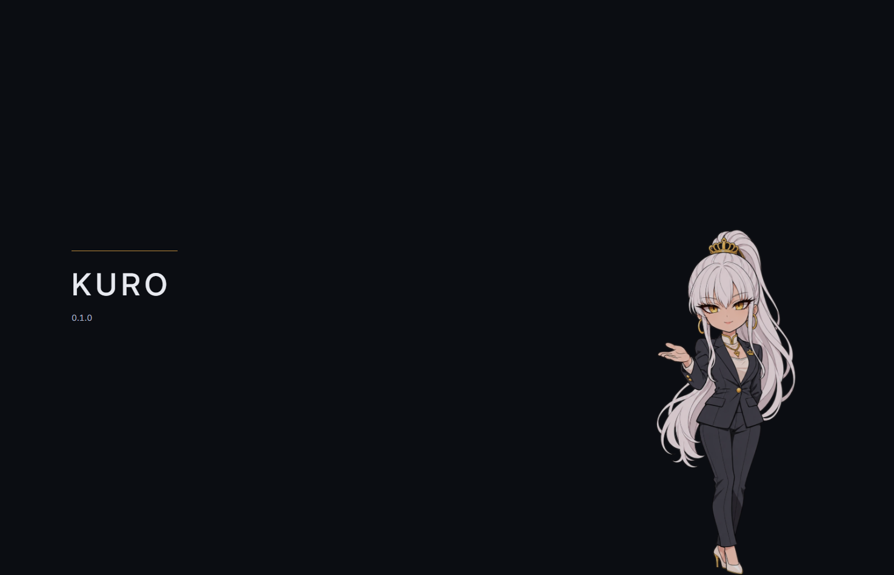
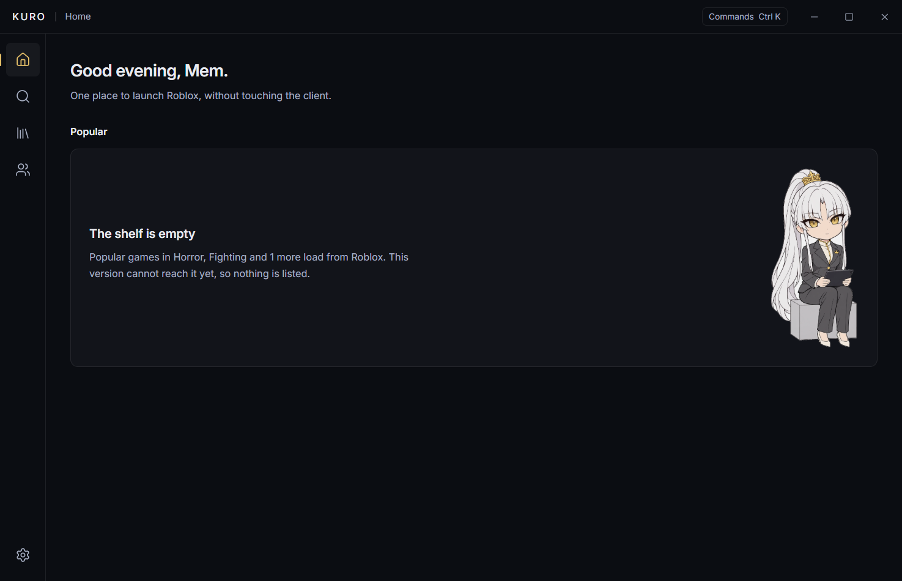
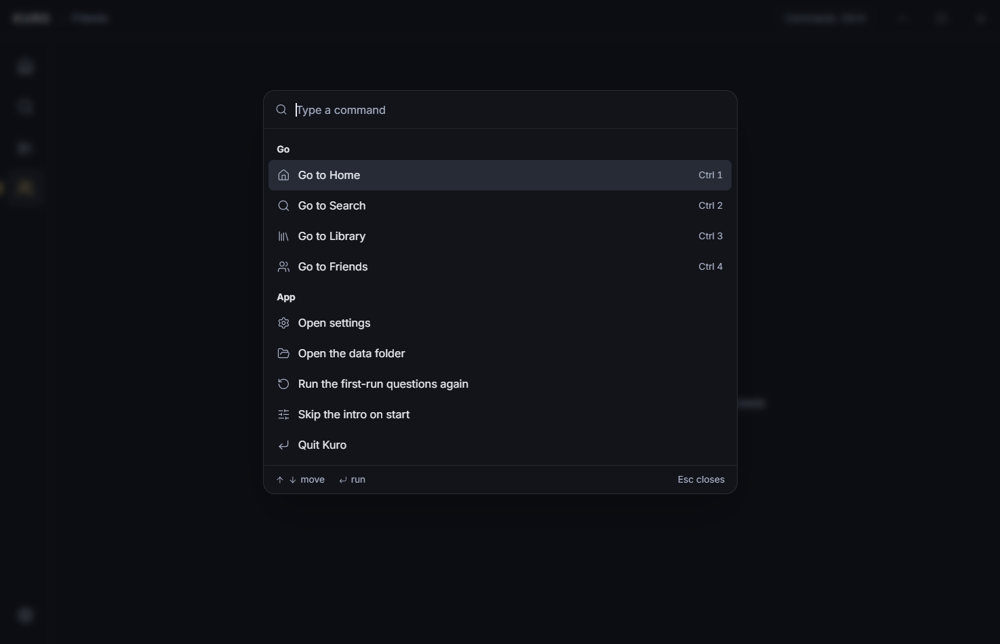

# Mem's Kuro Launcher

A third-party front end for Roblox. It gets you from a cold PC to inside the right
server, on the right account, with the right settings, and keeps working across
client updates. It never modifies the Roblox client.

Status: early. The shell, the theme and the first-run sequence are built. Version
management, accounts and launching come next, in that order.

## What it is not

It is not a cheat, a client mod or a bypass. It does not patch, re-sign or inject
into `RobloxPlayerBeta.exe`, and it does not touch Hyperion. It does not offer
region changes, fake presence or hardware spoofing. The only thing it does to
Roblox is speak the same protocols the website speaks.

## Screens

Captured from this build, not from a mockup.

**Intro**



**First run, three questions**


**Home, with nothing connected yet**



**Command palette on Ctrl K**



## Build from source

Requirements: Windows 10 or 11, Node 22 or newer, pnpm 10 or newer, Rust stable,
and the Microsoft C++ build tools with the Windows SDK.

```
pnpm install
pnpm tauri dev          # development window
pnpm tauri build --no-bundle   # release executable
```

The release executable lands in `src-tauri/target/release/kuro-launcher.exe`.
A full installer build (`pnpm tauri build`) produces NSIS and MSI packages.

## Where things live

One data root holds everything the app writes: `%APPDATA%\com.wassuplol.kuro`.
Deleting that folder resets the app cleanly. Put a file named `portable` beside
the executable and the whole root moves next to the executable instead.

## Security model

1. Session cookies are sealed with Windows DPAPI, bound to the Windows user, and
   stored as ciphertext only.
2. A cookie is only ever sent to `roblox.com`, never to a proxy and never to a
   server of ours. There is no server of ours.
3. The page never receives a cookie, a ticket or a key. The Rust half owns
   everything privileged.
4. Logs and diagnostics redact the home path, cookies, tickets and keys.
5. The updater checks a signature made with this project's own key and refuses
   anything else.

## Licence

MIT. See `LICENSE`.

Mem's Kuro Launcher is an unofficial third-party launcher. It is not affiliated
with, endorsed by or sponsored by Roblox Corporation. Roblox is a trademark of
Roblox Corporation.
