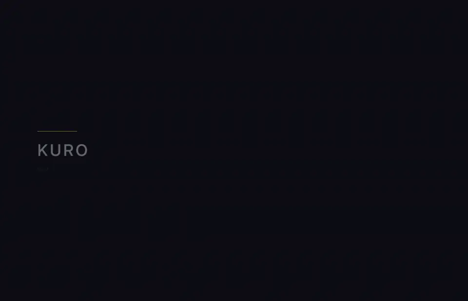
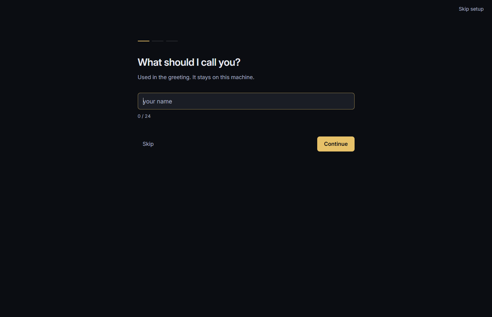
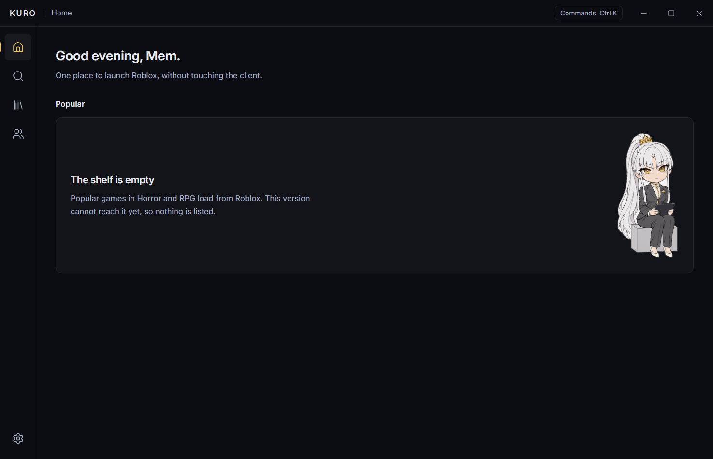
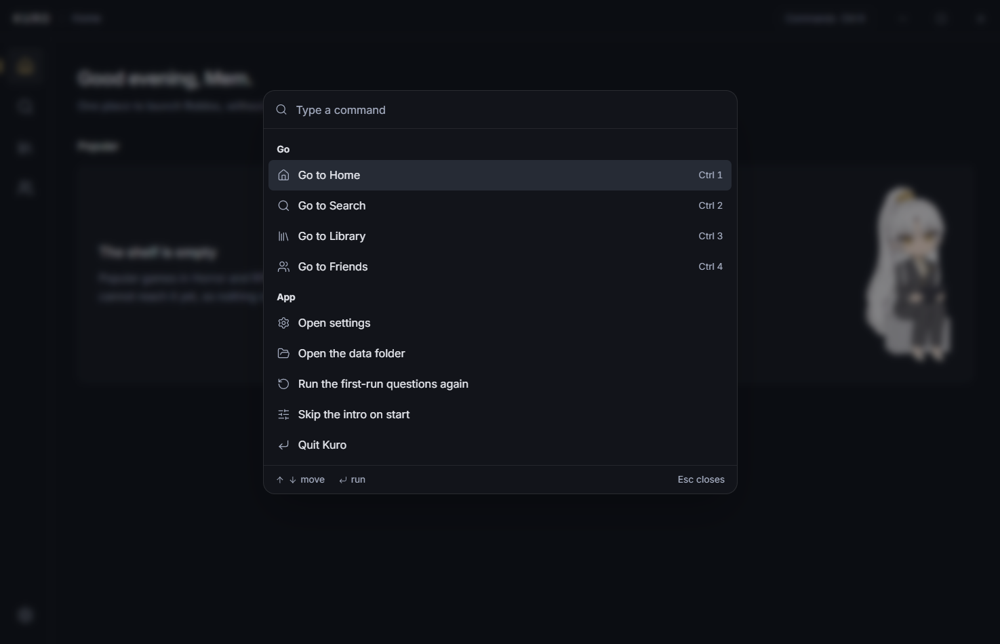
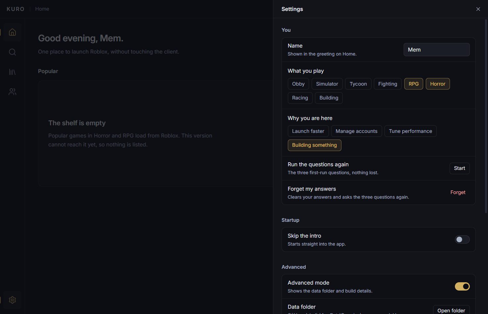
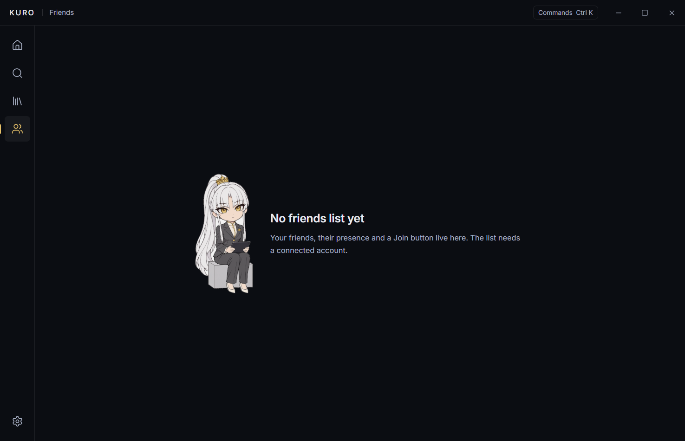
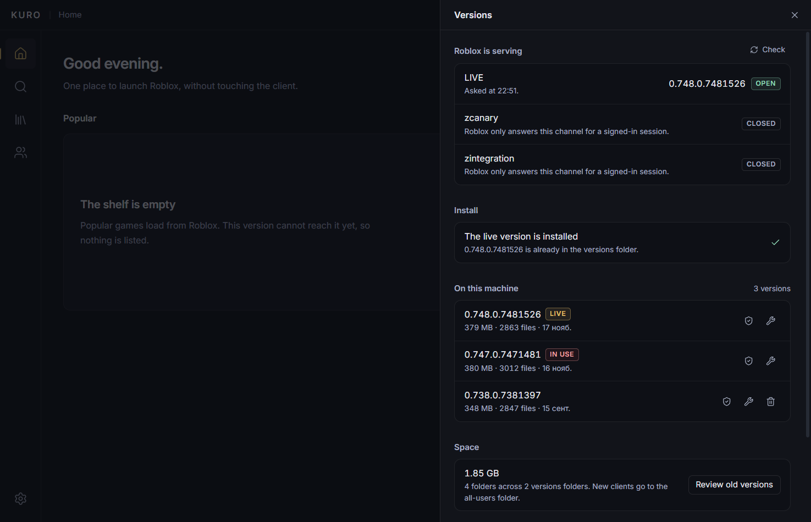

<p align="center">
  <picture>
    <source media="(prefers-color-scheme: dark)" srcset="assets/hero-dark.svg">
    <source media="(prefers-color-scheme: light)" srcset="assets/hero-light.svg">
    
  </picture>
</p>

<p align="center">
  <a href="https://github.com/Wassuplol/kuro-launcher/actions/workflows/ci.yml"></a>
  
  
  
</p>

<p align="center">
  
</p>

The official front end for Roblox is a website in a window. KURO is the same job
built as a desktop application: one place for your accounts, your client versions
and your settings, and a launch that lands in the right server the first time.

It is being built in the open, milestone by milestone. The shell and the client
manager are real. Accounts and launching come next, and the table below says
exactly where the line is.

## Where it is today

| Works today | Next |
|---|---|
| The window, the rail, four pages | Accounts, Quick Login, DPAPI vault (M3) |
| First run: three questions, stored locally | The launch pipeline, five modes (M4) |
| Client versions: discover, install, verify, pin, prune | Flags, profiles, precedence (M5) |
| A command palette with ten working commands | Discovery, then social, then the assistant |
| Settings, including reset and crash recovery | |
| Named failures: a code, a cause, an action | |

It talks to two Roblox endpoints and nothing else: the version service that says
which build is live, and the CDN that serves it. Every package is checked against
the hash Roblox publishes for it, and the unpacked client has to carry a
signature Windows trusts before it is allowed to stay. There is no server of
ours, and no telemetry in either direction.

## What it is not

Not a client mod and not a cheat. It never patches, re-signs or injects into
`RobloxPlayerBeta.exe`, and it never touches Hyperion. It offers no region
changes, no fake presence and no hardware spoofing. The only thing it does to
Roblox is speak the same protocols the website speaks.

## The shape of it

One process, two halves, a hard line between them. React renders and owns
nothing privileged. Rust owns the versions, the vault, the launch pipeline, the
flag writer and the protocol handlers. No secret reaches the page.

```text
┌──────────────────────────────┐          ┌───────────────────────────────┐
│  React 19                    │   IPC    │  Rust                         │
│  rendering only              │ ◄──────► │  versions, vault, launch,     │
│  no secrets, no file paths   │          │  flags, protocols, logs       │
└──────────────────────────────┘          └───────────────┬───────────────┘
                                                          │
                                                          ▼
                                                  Roblox client
```

Tauri 2 and Rust behind React 19 and TypeScript. The release binary is 8 MB,
because it uses the WebView2 that Windows already ships instead of bundling a
browser.

## Screens

<p align="center">
  
  
  
</p>

<p align="center">
  
  
</p>

<p align="center">
  
</p>

Every screen has an empty state that says why it is empty and what fills it. The
mascot appears on empty states and the intro only, never beside a failure.

## Build from source

Windows 10 or 11, Node 22 or newer, pnpm 10 or newer, Rust stable, and the
Microsoft C++ build tools with the Windows SDK.

```bash
pnpm install
pnpm tauri dev                  # development window
pnpm tauri build --no-bundle    # release executable
```

The release executable lands at `src-tauri/target/release/kuro-launcher.exe`.
A full installer build (`pnpm tauri build`) produces NSIS and MSI packages.

CI runs on every push: `pnpm audit`, `tsc --noEmit`, `cargo fmt --check`,
`clippy -D warnings`, `cargo deny`, then a release build whose executable is
uploaded as an artifact.

## The rules it will not break

1. It never patches, re-signs or injects into the client, and never touches Hyperion.
2. A flag exists for KURO only if the installed client's own string table contains the key. No invented flags.
3. A session cookie lives in the vault, goes to Roblox, and goes nowhere else.
4. No region changes, no fake presence, no hardware spoofing. That is the line between a launcher and a cheat.
5. A rate limit is printed on screen. If an endpoint allows three a minute, the number is visible.

## Security model

True in this build:

- Two Roblox endpoints are contacted, and nothing else. No telemetry, no analytics, no server of ours.
- Every downloaded package is hashed against the manifest Roblox publishes, and a mismatch is thrown away rather than installed.
- The unpacked client must carry a version resource naming Roblox Corporation and a signature Windows trusts, or the whole install is deleted.
- Installs are unpacked into a staging folder and moved into place with one rename, so a half-installed client is never visible to Roblox or to this app.
- A version that something is running out of is never removed, and the screen names the process.
- The page never receives a secret. The Rust half owns every privileged action.
- Settings are written through a temporary file and a rename, so a crash cannot leave a half-written file behind.
- A settings file that cannot be read does not stop the app: it starts on defaults and offers a reset.

Enforced as each layer lands:

1. Session cookies sealed with Windows DPAPI, bound to the Windows user, ciphertext on disk only.
2. A cookie only ever sent to `roblox.com`, never to a proxy, never to a server of ours. There is no server of ours.
3. Logs and diagnostics that redact the home path, cookies, tickets and keys, with a test that proves it.
4. An updater that verifies a signature made with this project's own key and refuses anything else.

## The name

Kuro is black in Japanese. Aiko Kuro is the character in the corner: white hair,
gold eyes, charcoal suit, and the same calm register as the app's copy. She
appears on empty states and in the intro, never on a button, never beside a
failure, and never animated on a loop.

<p align="center">
  
</p>

## Licence

MIT. See [LICENSE](LICENSE).

Mem's Kuro Launcher is an unofficial third-party launcher. It is not affiliated
with, endorsed by or sponsored by Roblox Corporation. Roblox is a trademark of
Roblox Corporation.
