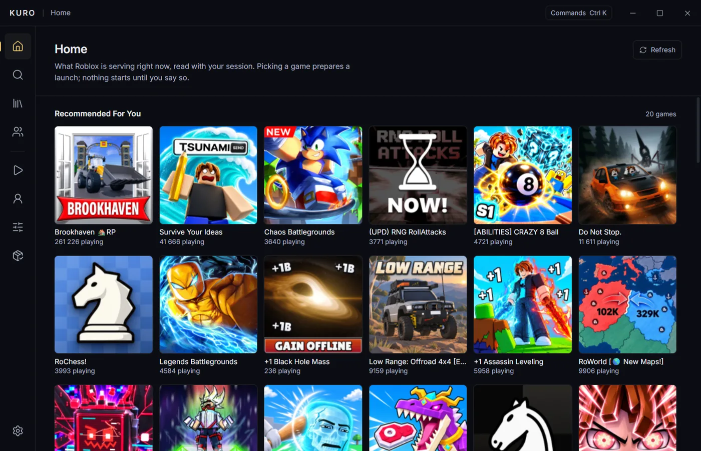
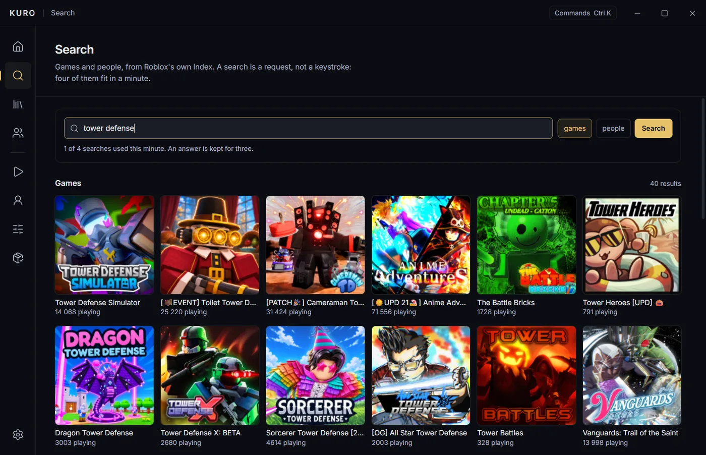
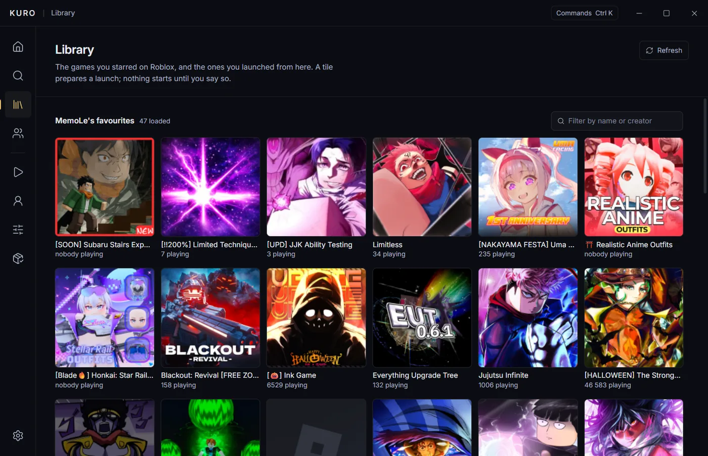
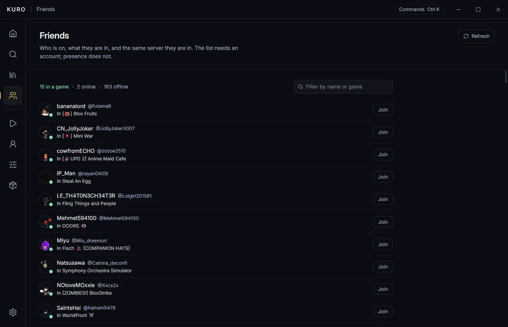
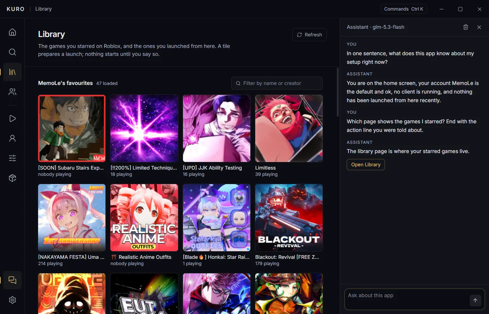
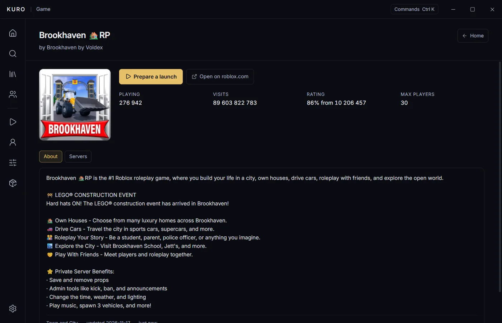

<p align="center">
  <picture>
    <source media="(prefers-color-scheme: dark)" srcset="assets/hero-dark.svg">
    <source media="(prefers-color-scheme: light)" srcset="assets/hero-light.svg">
    
  </picture>
</p>

<p align="center">
  <a href="https://github.com/Wassuplol/kuro-launcher/actions/workflows/ci.yml"></a>
  
  
  
</p>

<p align="center">
  
</p>

The official Roblox front end is a website in a window. KURO is the same job built
as a desktop application: your accounts, your client versions, your flags and the
games Roblox is serving, with a launch that lands where you pointed it.

Everything here talks to Roblox's own endpoints with your own session. There is no
KURO server, no account to create, and nothing to sign up for.

## Get it

Windows 10 and 11, x64. The installers and a portable exe are on the
[releases page](https://github.com/Wassuplol/kuro-launcher/releases/latest).

The builds are unsigned, so Windows warns once before the installer runs. Every file
on a release has its SHA-256 in `SHA256SUMS.txt` beside it: put the files in one
folder and run `sha256sum -c SHA256SUMS.txt` before running anything.

## What works today

| Works | Notes |
|---|---|
| **Home** | Roblox's discovery feed, hydrated into tiles: icon, name, players. Six across, live counts |
| **Search** | Games and people from Roblox's index, one deliberate query at a time |
| **Game page** | Description, visits, rating, max players, and the public server list on a tab |
| **Library** | The games the account has starred, paged and filterable, and this machine's own record of what it launched |
| **Friends** | The account's friends with live presence, and a Join that lands in the exact server a friend is in |
| **Assistant** | A pane docked beside the page, streamed as it writes. It reads the current screen, the saved accounts and what is running, proposes one action at a time, and never starts anything itself |
| **Accounts** | Quick Login (six-character code or QR), cookie import, DPAPI vault, session health, forget, default |
| **Launch** | A place id, a game link, a private invite, a friend, or one exact server. One client at a time, idempotent |
| **Versions** | Discover across both install roots, direct install with hash and signature checks, pin, prune, verify, repair |
| **Flags** | Roblox's own 25,585-key catalogue, named profiles, a per-flag scope chain, and a write you can undo |
| **Shell** | Eight pages, a command palette, settings, named failures with a code, a cause and an action |
| **Install** | NSIS and MSI installers and a portable exe, built by CI on a tag, with SHA-256 for every file |

<p align="center">
  
</p>

<p align="center">
  
</p>

<p align="center">
  
</p>

<p align="center">
  
</p>

## What is not built

| Missing | Why it is not here |
|---|---|
| A signed installer | No code-signing certificate, so SmartScreen warns once on first run. The hashes are the substitute: check them before you run anything |
| An updater | The app never phones home for anything but Roblox, so an update is a download, not a push |

## Three things this app had to measure, not assume

Roblox's docs are thinner than its behaviour, so the code carries the measurements
that decided its shape. Each one is a comment beside the constant it produced.

**Fast Flags are allowlisted.** The client reads `ClientAppSettings.json` from the
version folder it is about to run, as JSON **strings**, and then silently drops
every key that is not on Roblox's 18-key allowlist. `DFIntTaskSchedulerTargetFps`,
the one flag everybody sets, is not on it. So the Flags page marks every key with
whether the client will honour it, and the launch report counts what will actually
be applied instead of what was written.

**The discovery feed carries ids, not games.** `omni-recommendation` answers six
sorts of `{contentType, contentId}`; names, players and icons are a second call, and
`games?universeIds=` refuses 100 ids with `Too many universe IDs were requested`.
Fifty is the cap, and every grid on the home page is hydrated in batches of it.

**Rate limits differ by two orders of magnitude on the same host.** Search allows
four calls a minute, the public server list three, game details sixty, thumbnails
fifteen hundred. The budget is keyed per endpoint class rather than per host, which
is why the search box submits instead of typing, and why the server list is behind
a tab.

**A streamed answer is a socket, not a JSON body.** The assistant posts with
`stream: true`, reads `text/event-stream` line by line and forwards each delta as an
event while the command is still running, so the pane paints as the model writes. A
stop flag is checked between deltas, because a Stop that only stops listening leaves
the model talking to nobody.

**Presence is priced twice.** A friend list is twenty calls a minute, the tightest
budget in the app, and it comes back as ids with empty names, so it is two more calls
to make it readable. Presence then accepts 200 ids with a session and refuses 100
without one (`Too many User Ids being sent in the request`), which is why the cookie
is sent with a call that works without it: the ceiling, not the permission, is what
the session buys.

<p align="center">
  
</p>

## How it is built

Rust for everything that touches the machine or the network, React for the window.

```
src-tauri/src/
  discovery/   the request budget, a TTL cache, the wire shapes, feed and search
  identity/    the DPAPI vault, Quick Login, the account store
  launch/      target parsing, ticket minting, the roblox-player string, spawn
  supply/      install roots, the package manifest, direct install, verify, prune
  flags/       the catalogue, profiles, scopes, the allowlist, the lease
  library.rs   this machine's own record of what it launched
  social.rs    the friend list, names, faces and live presence
  assistant.rs the forwarded conversation: resolved config, SSE streaming, the prompt
  error.rs     every failure has a code, a cause and an action
src/
  screens/     Home, Search, Game, Launch, Accounts, Flags, Versions, Library, Friends
  panels/      the bodies of those pages, plus the palette and settings drawers
  store/       zustand: shell, accounts, versions, flags, discovery, library
tools/
  cdp.mjs         drives the running webview over the Chrome DevTools Protocol
  page-layout.mjs walks every page and fails on overlapping blocks or a pinned element
```

Two rules keep it honest. A session cookie never reaches the page: it is unsealed
inside one Rust call and used there. And `tools/page-layout.mjs` is the reason a
layout bug cannot ship twice: it clicks the rail through every page and asserts the
geometry a screenshot cannot be trusted to show.

## Build it

Needs Node 22, pnpm 11, Rust stable and the WebView2 runtime (Windows 10 and 11
have it).

```bash
pnpm install
pnpm tauri dev            # the app, with hot reload
pnpm tauri build --no-bundle   # a release binary in src-tauri/target/release
```

Checks, the same ones CI runs:

```bash
pnpm exec tsc --noEmit
cargo test --manifest-path src-tauri/Cargo.toml
cargo clippy --manifest-path src-tauri/Cargo.toml --all-targets -- -D warnings
cargo fmt --manifest-path src-tauri/Cargo.toml --check
cargo deny --manifest-path src-tauri/Cargo.toml check
```

## The line it does not cross

KURO never touches the game client. It reads the registry to find the handler,
lists version folders, mints a login ticket, builds the same `roblox-player:` string
the website builds, and starts the process. No injection, no memory reads, no
patched files, and the client it launches is byte-identical to the one Roblox
installed.

The one thing it writes is the flag file, and only as a lease: it is put in place
before a launch, and the previous state is restored when that client exits, when the
launcher closes, or on the next start if the last run died.

## Licence

MIT. Roblox is a trademark of Roblox Corporation; this project is not affiliated
with or endorsed by it.
